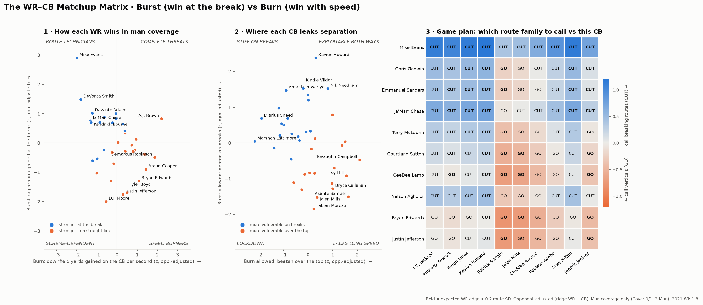

# The WR–CB Matchup Matrix : Burst vs Burn

**▶ Rapport de scouting interactif : https://valeferm.github.io/nfl-wr-cb-matchup-matrix/**

Un receveur ne bat pas son défenseur d'une seule façon : nous décomposons la séparation en **man coverage** en **Burst** (séparation gagnée pendant un *cut*, rupture de direction et du corps terminée avant le lancer) et **Burn** (yards gagnés vers l'avant sur le CB, par seconde, sur un tracé vertical lancé). Sur 3 865 duels WR–CB reconstruits automatiquement depuis le tracking NGS (Cover-0/1 et 2-Man, semaines 1 à 8 de 2021), un modèle ridge ajusté à l'adversaire profile 36 WR et 38 CB, et prédit mieux que la moyenne ligue des matchs qu'il n'a jamais vus. Ces duels décident des passes : quand le WR ciblé gagne sa rupture, la passe est complétée **71 % du temps contre 41 %** quand il la perd (p < 0,001 ; sur les verticaux, 45 % contre 35 % selon le Burn, une tendance non significative à ce volume). Le résultat est une matrice de game-planning qui dit au coordinateur offensif **quelle famille de tracés appeler contre quel CB** : face aux Chargers, Davante Adams doit jouer des **CUT** contre Michael Davis, mais des **GO** contre Asante Samuel, qui suit très bien les ruptures mais concède 2,6 yd/s en vertical (97e percentile). Limite : 8 semaines de données, donc des profils fortement rétrécis vers la moyenne, à lire comme des tendances de scouting et non comme des certitudes.

## Le site : un outil de décision pour le staff

Site bilingue (FR / EN), thème clair ou sombre. On règle la situation (tentative, yards à gagner, position du ballon) et l'outil donne, pour chaque duel WR–CB, l'appel optimal (CUT ou GO) avec sa **probabilité de complétion, de 1er down et les yards attendus**, plus le **% de simulations** (100 rééchantillonnages des matchs, modèle entièrement réajusté) dans lesquelles cet appel, ou ce corner, est le meilleur choix. Côté attaque : quel corner viser. Côté défense : quel corner mettre sur quel receveur. La page d'accueil prépare **Saints contre Steelers** (le match de Paris 2026) ; les fiches joueurs affichent le 40 yards du Combine (nflverse) et l'arbre de tracés réel du receveur sur un terrain.



## Comment lancer

```bash
git clone https://github.com/ThompsonJamesBliss/nfl-big-data-bowl-regional-event-data.git /tmp/bdb
cp -r /tmp/bdb/data ./data          # games.csv, plays.csv, players.csv, pffScoutingData.csv, tracking/
mkdir -p data/external && curl -L -o data/external/combine.csv https://github.com/nflverse/nflverse-data/releases/download/combine/combine.csv  # 40 yards (optionnel)
pip install -r requirements.txt      # pandas, numpy, scipy, matplotlib, pyarrow
python main.py                       # jeu complet, quelques secondes (cache parquet ensuite)
python main.py --sample 50           # prototype sur 50 actions
```

Sorties : `outputs/matchup_matrix.png`, `outputs/*_profiles.csv`, `outputs/matchup_edge_cut_minus_vertical.csv`, `outputs/routes.csv`, et `docs/data.js` qui alimente le site (`docs/index.html`, une page statique sans dépendance, ouvrable en local).

## Méthode

| Étape | Choix |
|---|---|
| Normalisation | Les actions vers la gauche pivotent de 180° (x, y, `dir`, `o`) : toutes les attaques vont vers +x. |
| Duel man | Coureur de route (WR/TE/RB) et défenseur en couverture *mutuellement* les plus proches sur la 1re seconde (appariement 1-1). Le duel est gardé si ce défenseur reste le plus proche sur au moins 70 % des frames jusqu'au lancer, à 8 yd en moyenne au maximum. On garde WR vs CB. |
| Cut | `dir` tourne de ≥ 40° et `o` de ≥ 25° en 0,8 s, à ≥ 2 yd/s, au moins 2 yd au-delà de la ligne de mêlée, fenêtre **terminée avant le lancer** (sinon un pass breakup biaiserait la mesure). |
| Vertical | Pas de cut, au moins 7 yd de profondeur au lancer, à moins de 30° de l'axe du terrain. Le Burn n'utilise pas la distance brute, qui diminue quand le WR mange le coussin d'un CB en off. |
| Profils | Ridge `route = moyenne + effet WR + effet CB`. Lambda choisi par validation croisée sur les matchs (pairs / impairs). R² hors échantillon : +2,7 % (Burst), +3,5 % (Burn). Éligibilité : au moins 15 tracés, dont au moins 5 de chaque famille. |
| Appel | Avantage attendu par famille = (effet WR + effet CB) / écart-type de la métrique. On appelle la famille dont l'avantage est le plus grand. |
| Validation | Cible de chaque passe extraite du play-by-play (`playDescription`). On compare le taux de complétion selon que le duel est gagné ou perdu. |
| Décision | Logistique « complétion ~ Burst » (cuts) et « complétion ~ Burn » (verticaux) sur les routes ciblées, moyennée sur le bruit d'une répétition à l'autre. Distribution ligue des yards après réception, par famille, pour le 1er down et les yards attendus (plafonnés à l'en-but). Bootstrap par matchs (100 tirages) sur les profils, le modèle de complétion et les yards. |
| Données externes | Temps au 40 yards du Combine NFL (nflverse, public), affichés pour le contexte, non utilisés par le modèle. Le fichier `data/external/combine.csv` provient de `https://github.com/nflverse/nflverse-data/releases/download/combine/combine.csv`. |

Tout le calcul spatio-temporel est vectorisé (pandas, NumPy, SciPy sparse) : pas de boucle sur les frames. Le pipeline complet tourne en quelques secondes.
