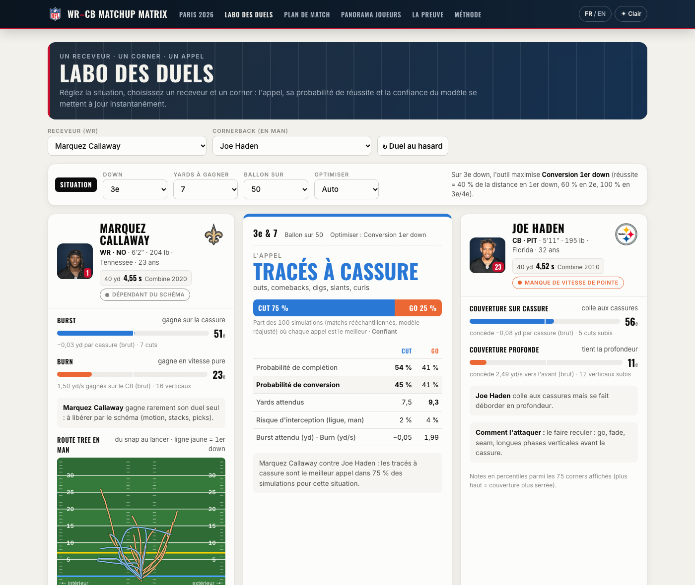
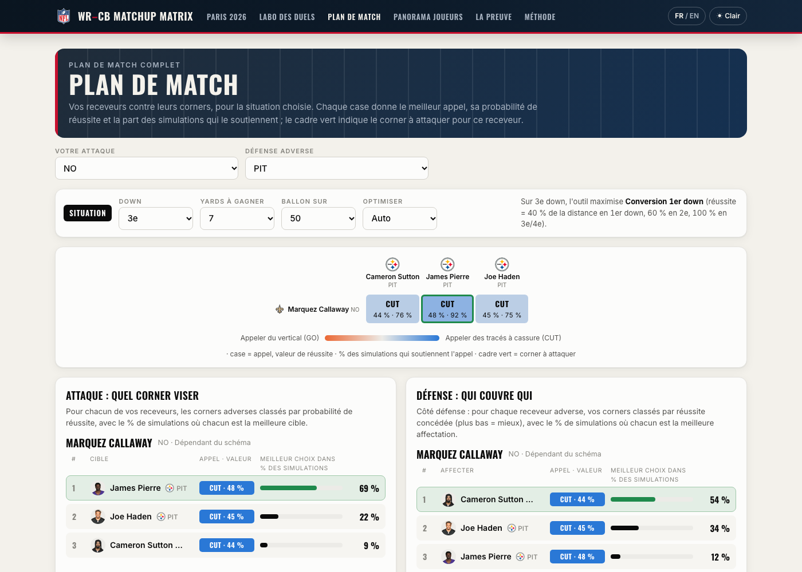
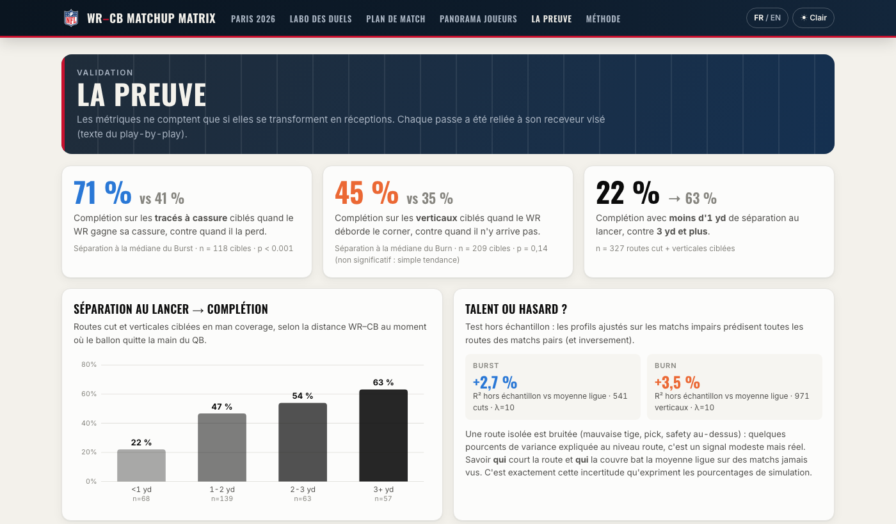

# 🏈 WR–CB Matchup Matrix : Burst vs Burn

### ▶ **[Ouvrir l'outil en ligne : valeferm.github.io/nfl-wr-cb-matchup-matrix](https://valeferm.github.io/nfl-wr-cb-matchup-matrix/)** · FR / EN · clair / sombre · mobile

[](https://valeferm.github.io/nfl-wr-cb-matchup-matrix/)

Un receveur ne bat pas son défenseur d'une seule façon : à partir du tracking Next Gen Stats, nous décomposons la séparation en **man coverage** en **Burst** (séparation gagnée sur une *cassure*, avant le lancer) et **Burn** (terrain gagné sur le CB, par seconde, en ligne droite à pleine vitesse). Sur **3 865 duels WR–CB** reconstruits automatiquement (Cover-0/1 et 2-Man, semaines 1 à 8 de 2021), un modèle ajusté à l'adversaire profile 73 receveurs et 75 cornerbacks, et prédit mieux que la moyenne ligue des matchs qu'il n'a jamais vus. Ces duels décident des passes : quand le receveur ciblé gagne sa cassure, la passe est complétée **71 % du temps contre 41 %** quand il la perd (p < 0,001). Pour le coordinateur, l'outil répond à la vraie question du bord de terrain, *« pour ce down et cette distance, quel tracé appeler contre ce corner, et quel corner attaquer ? »*, avec des probabilités de réussite et le pourcentage de simulations qui soutient chaque choix. Limites : 8 semaines de données (effectifs 2021) et des familles de tracés déduites de la géométrie ; les profils sont donc volontairement prudents et se lisent comme des tendances de scouting, pas comme des certitudes.

---

## Ce que le staff obtient

| | |
|---|---|
| **Labo des duels** : un receveur, un corner, une situation (down, distance, position du ballon). L'outil donne l'appel (**CUT** ou **GO**), sa probabilité de complétion, de conversion et les yards attendus, et le **% des 100 simulations** dans lesquelles cet appel est le meilleur. La fiche joueur affiche la photo, le 40 yards du Combine et le *route tree* réel du receveur sur un terrain. | [](https://valeferm.github.io/nfl-wr-cb-matchup-matrix/#lab) |
| **Plan de match** : vos receveurs contre leurs corners. Pour chaque duel, l'appel et sa valeur ; côté attaque, **quel corner viser** ; côté défense, **quel corner mettre sur quel receveur**, chacun avec le % de simulations où il est le meilleur choix. | [](https://valeferm.github.io/nfl-wr-cb-matchup-matrix/#plan) |
| **La preuve** : le lien entre nos métriques et les passes complétées, avec tests de significativité et R² hors échantillon. | [](https://valeferm.github.io/nfl-wr-cb-matchup-matrix/#proof) |

La page d'accueil prépare le **NFL Paris Game du 25 octobre 2026 au Stade de France** (Saints contre Steelers) : les clés du match pour chaque attaque et chaque défense.

## Résultats clés

| | |
|---|---|
| Duels reconstruits | **3 865** duels WR–CB en man (2 481 dropbacks, 122 matchs), dont 541 cuts et 1 299 verticaux |
| Gagner sa cassure paie | **71 % vs 41 %** de complétion sur les tracés à cassure ciblés (n = 118, p < 0,001) |
| La séparation au lancer | **22 % → 63 %** de complétion entre moins d'1 yd et 3 yd ou plus de séparation |
| Un vrai signal individuel | R² hors échantillon positif sur des matchs jamais vus : **+2,7 %** (Burst), **+3,5 %** (Burn), modeste et attendu au niveau d'une route isolée |
| Le corner compte | Sur les verticaux, l’effet du CB (écart-type 0,26 yd/s) dépasse nettement celui du WR (0,18) : choisir **qui** attaquer est aussi important que **comment** |
| Tendance honnête | Sur les verticaux, 45 % vs 35 % de complétion selon le Burn, **non significatif** (p = 0,14) : affiché comme une simple tendance |

## Méthode

| Étape | Choix |
|---|---|
| Normalisation | Les actions vers la gauche pivotent de 180° (x, y, `dir`, `o`) : toutes les attaques vont vers +x. |
| Qui couvre qui | Les données ne le disent pas. Chaque coureur de route (WR/TE/RB) est apparié au défenseur en couverture *mutuellement* le plus proche sur la 1re seconde après le snap (appariement 1-1). Le duel est gardé si ce défenseur reste le plus proche sur ≥ 70 % des frames jusqu'au lancer, à ≤ 8 yd en moyenne. |
| Cut | `dir` tourne de ≥ 40° et `o` de ≥ 25° en 0,8 s, à ≥ 2 yd/s, ≥ 2 yd au-delà de la ligne de mêlée. La fenêtre doit être **terminée avant le lancer** (sinon un pass breakup biaiserait la mesure). **Burst** = variation de la distance WR–CB sur la fenêtre. |
| Vertical | Pas de cut, ≥ 7 yd de profondeur au lancer, à moins de 30° de l'axe. **Burn** = yards gagnés vers l'avant sur le CB par seconde, à ≥ 5 yd/s. La distance brute ne convient pas : elle diminue quand le WR mange le cushion d'un corner en off, même quand il gagne. |
| Profils | Ridge `route = moyenne + effet WR + effet CB` (ajustement à l'adversaire). Lambda choisi par validation croisée sur les matchs. Au moins 8 tracés (≥ 3 de chaque famille). |
| Décision | Logistique *complétion ~ Burst* (cuts) et *complétion ~ Burn* (verticaux) sur les routes ciblées, moyennée sur le bruit d'une répétition à l'autre. **Taux de réussite** selon le down (gain ≥ 40 % / 60 % / 100 % de la distance en 1er / 2e / 3e–4e) et yards attendus, à partir de la distribution ligue des yards après réception (plafonnée par l'en-but). |
| Incertitude | Bootstrap par matchs (100 tirages) : profils, modèle de complétion et yards sont réajustés à chaque tirage. Chaque appel et chaque corner affiche le % de simulations où il est le meilleur choix. |
| Validation | Cible de chaque passe extraite du play-by-play (`playDescription`) : complétion selon que le duel est gagné ou perdu, test de différence de proportions. |

Tout le calcul spatio-temporel est **vectorisé** (pandas, NumPy, SciPy sparse), sans boucle sur les frames : le pipeline complet tourne en environ 5 secondes.

## Comment lancer

```bash
git clone https://github.com/ValeFerm/nfl-wr-cb-matchup-matrix.git && cd nfl-wr-cb-matchup-matrix
git clone https://github.com/ThompsonJamesBliss/nfl-big-data-bowl-regional-event-data.git /tmp/bdb && cp -r /tmp/bdb/data ./data
pip install -r requirements.txt     # pandas, numpy, scipy, matplotlib, pyarrow
python main.py                      # pipeline complet, environ 5 s ; --sample 50 pour un prototype
open docs/index.html                # le site fonctionne aussi en local, sans serveur
```

Optionnel (40 yards du Combine) : `curl -L -o data/external/combine.csv https://github.com/nflverse/nflverse-data/releases/download/combine/combine.csv`

## Structure du dépôt

| Fichier | Rôle |
|---|---|
| `main.py` | Orchestration : tracking, duels, métriques, profils, validation, export |
| `src/load.py` | Chargement, filtre man coverage, normalisation du terrain, cache parquet |
| `src/metrics.py` | Duels 1-1, détection des cuts, Burst et Burn (vectorisé) |
| `src/scoring.py` | Ridge WR + CB, validation croisée, matrice d'avantage |
| `src/validate.py` | Cible de chaque passe, complétion selon le duel, tests |
| `src/decision.py` | Modèle de complétion, yards par famille, bootstrap, 40 yards |
| `src/viz.py` · `src/export_web.py` | Figure statique (`outputs/matchup_matrix.png`) et données du site (`docs/data.js`) |
| `docs/` | Le site (page statique, sans dépendance) |

## Données et crédits

Tracking **NFL Next Gen Stats** et scouting **PFF** (jeu de données fourni, 2021, semaines 1 à 8). Temps du Combine et photos des joueurs via [nflverse](https://github.com/nflverse/nflverse-data) (données publiques, photos NFL.com). Logos des équipes et de la NFL via le CDN public d'ESPN. Construit en 3 heures pour le **NFL Big Data Bowl : Paris Side Quest** (AWS × NFL, Epitech Paris, 21 octobre 2026).
